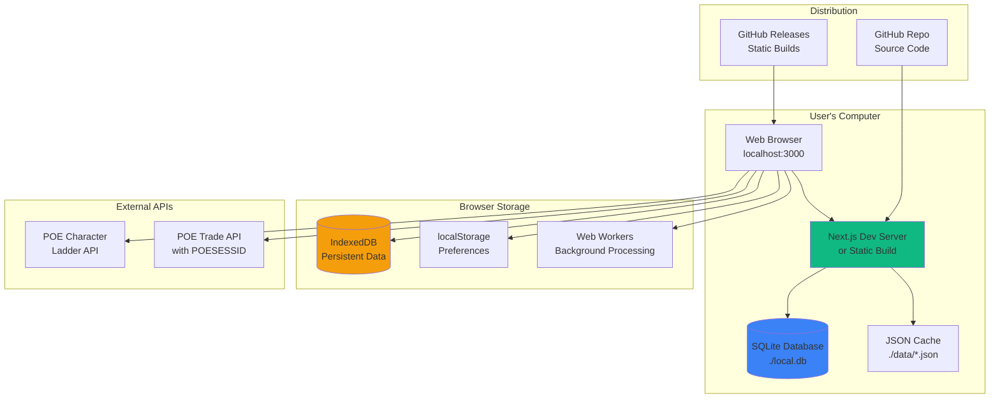
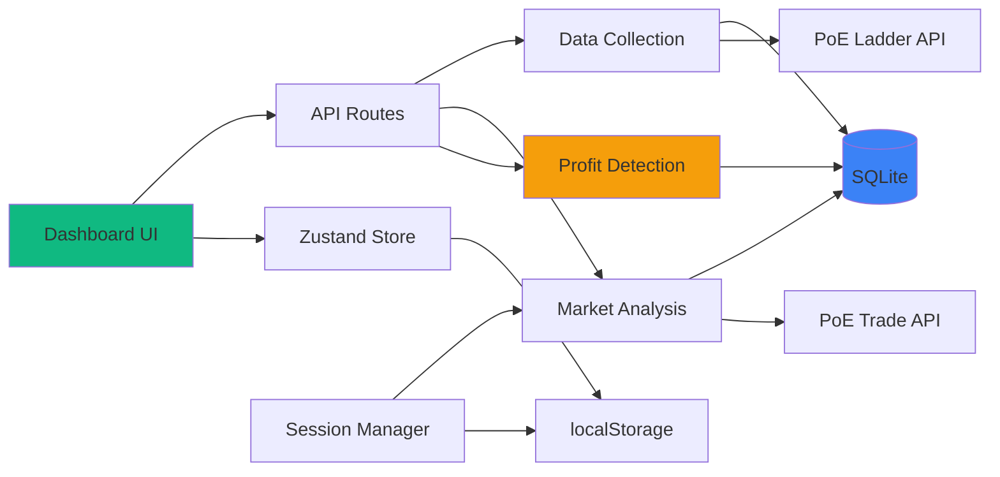

# Path of Exile 2 Trading Assistant App Fullstack Architecture Document

## Introduction

This document outlines the complete fullstack architecture for **POE Profit Assistant**, including backend systems, frontend implementation, and their integration. It serves as the single source of truth for AI-driven development, ensuring consistency across the entire technology stack.

This unified approach combines what would traditionally be separate backend and frontend architecture documents, streamlining the development process for modern fullstack applications where these concerns are increasingly intertwined.

### Starter Template or Existing Project

N/A - Greenfield project

### Change Log

| Date       | Version | Description                                   | Author              |
| ---------- | ------- | --------------------------------------------- | ------------------- |
| 2025-09-20 | 1.0     | Initial architecture document creation        | Winston (Architect) |
| 2025-09-20 | 1.1     | Revised to zero-cost local-first architecture | Winston (Architect) |

## High Level Architecture

### Technical Summary

The POE Profit Assistant operates as a **local-first desktop application** using Next.js running locally with all data processing happening client-side. The system connects directly to Path of Exile's Character Ladder and Trade APIs from the browser using user-provided credentials (POESESSID), eliminating need for backend infrastructure costs. Data persistence uses SQLite for development and IndexedDB for browser-based storage, with JSON file caching for API responses. The architecture prioritizes zero-cost operation during MVP validation while maintaining sub-200ms response times through local data processing. This approach enables solo developer validation of the core profit detection algorithm with no monthly hosting costs while providing a clear migration path to cloud infrastructure post-validation.

### Platform and Infrastructure Choice

**Platform:** Local-First Development (Zero Infrastructure Cost)
**Key Services:**

- Next.js Development Server (local port 3000)
- SQLite Database (file-based local storage)
- Browser IndexedDB (client-side persistence)
- localStorage (user preferences & session)
- JSON File Cache (./data directory)
- Node.js Scripts (optional background processing)

**Deployment Host and Regions:**

- Development: User's local machine
- Distribution: GitHub releases or static file sharing
- Optional: GitHub Pages for static hosting (free)

### Repository Structure

**Structure:** Monorepo - Single repository with local-first design
**Monorepo Tool:** Not needed (single app, no workspaces required)
**Package Organization:**

- Single Next.js app with all logic colocated
- Client-side analysis in `lib/analysis`
- Local database logic in `lib/db`
- API clients in `lib/api` (browser-compatible)
- Static data cache in `data/` directory

### High Level Architecture Diagram



### Architectural Patterns

- **Local-First Architecture:** All data processing and storage happens on user's machine - _Rationale:_ Zero infrastructure costs while validating core algorithm effectiveness
- **Client-Side Processing:** Browser-based analysis using Web Workers for heavy computation - _Rationale:_ Leverages user's computing power without server costs
- **File-Based Database:** SQLite for development, IndexedDB for production - _Rationale:_ No database hosting costs while maintaining full query capability
- **Direct API Pattern:** Browser connects directly to PoE APIs - _Rationale:_ Eliminates need for backend proxy while respecting rate limits
- **Progressive Enhancement:** Start with manual refresh, add auto-refresh later - _Rationale:_ Simpler initial implementation without background job complexity
- **Static Distribution:** Ship as static files users can run locally - _Rationale:_ No hosting required, users control their own instance
- **Component-Based UI:** Reusable React components with TypeScript - _Rationale:_ Maintainability and type safety for complex dashboard interactions

## Tech Stack

This is the DEFINITIVE technology selection for the entire project. All choices are optimized for zero-cost local development while maintaining professional quality.

### Technology Stack Table

| Category             | Technology            | Version | Purpose                      | Rationale                                         |
| -------------------- | --------------------- | ------- | ---------------------------- | ------------------------------------------------- |
| Frontend Language    | TypeScript            | 5.3+    | Type-safe development        | Strong typing for complex item data structures    |
| Frontend Framework   | Next.js               | 14+     | Full-stack React framework   | Excellent DX, can run locally or build static     |
| UI Component Library | Radix UI              | Latest  | Headless components          | Accessible, unstyled components for custom design |
| State Management     | Zustand               | 4.4+    | Client state management      | Simple, lightweight alternative to Redux          |
| Backend Language     | TypeScript            | 5.3+    | API routes & processing      | Same language across stack                        |
| Backend Framework    | Next.js API Routes    | 14+     | Serverless functions locally | Built into Next.js, no separate backend           |
| API Style            | REST                  | -       | Simple HTTP endpoints        | Straightforward for client-side calls             |
| Database             | SQLite                | 3.x     | Local data storage           | Zero-cost file-based database                     |
| Cache                | JSON Files            | -       | API response caching         | Simple file-based caching                         |
| File Storage         | Local FS              | -       | Data and cache files         | User's file system                                |
| Authentication       | localStorage          | -       | Session token storage        | Simple browser storage for POESESSID              |
| Frontend Testing     | Vitest                | 1.0+    | Unit testing                 | Fast, Vite-based testing                          |
| Backend Testing      | Vitest                | 1.0+    | API route testing            | Same tool for consistency                         |
| E2E Testing          | Playwright            | 1.40+   | End-to-end testing           | Works great with local apps                       |
| Build Tool           | Vite (via Next.js)    | 5.0+    | Build optimization           | Built into Next.js                                |
| Bundler              | Webpack (via Next.js) | 5.x     | Module bundling              | Built into Next.js                                |
| IaC Tool             | N/A                   | -       | Not needed                   | Local-first, no infrastructure                    |
| CI/CD                | GitHub Actions        | -       | Build validation             | Free for public repos                             |
| Monitoring           | Console Logging       | -       | Development debugging        | Simple, built-in                                  |
| Logging              | Winston               | 3.11+   | Structured logging           | File-based logs locally                           |
| CSS Framework        | TailwindCSS           | 3.4+    | Utility-first CSS            | Rapid UI development                              |

## Data Models

Define the core data models/entities that will be shared between frontend and backend. These models represent the fundamental business objects in the POE trading ecosystem.

### Character

**Purpose:** Represents a Path of Exile character from the ladder API, containing equipment and build information used for demand analysis.

**Key Attributes:**

- name: string - Character name from ladder
- level: number - Character level (1-100)
- class: string - Character class (e.g., "Witch", "Marauder")
- league: string - Current league the character plays in
- items: Item[] - Array of equipped items
- skills: Skill[] - Active skill gems being used
- fetchedAt: Date - When this data was retrieved

#### TypeScript Interface

```typescript
interface Character {
  id: string
  name: string
  level: number
  class: string
  league: string
  items: Item[]
  skills: Skill[]
  experience: number
  depth?: number // Delve depth if applicable
  fetchedAt: Date
  accountName?: string
}
```

#### Relationships

- Has many Items (equipped)
- Has many Skills (active gems)
- Analyzed to create DemandMetrics

### Item

**Purpose:** Represents an item in Path of Exile, either equipped on a character or listed for trade.

**Key Attributes:**

- name: string - Unique or base item name
- baseType: string - Base item type (e.g., "Astral Plate")
- itemLevel: number - Item level for crafting
- rarity: string - Normal/Magic/Rare/Unique
- sockets: SocketInfo - Socket configuration
- mods: string[] - Item modifiers/affixes
- corrupted: boolean - Corruption status

#### TypeScript Interface

```typescript
interface Item {
  id: string
  name: string
  baseType: string
  itemLevel: number
  rarity: 'Normal' | 'Magic' | 'Rare' | 'Unique'
  category: string // Weapon, Armour, Jewelry, etc.
  sockets?: {
    total: number
    links: number
    colors: string // e.g., "RRRGGB"
  }
  mods: string[]
  implicitMods?: string[]
  explicitMods?: string[]
  corrupted: boolean
  influences?: string[] // Elder, Shaper, etc.
  stackSize?: number
  identified: boolean
}
```

#### Relationships

- Belongs to Character (when equipped)
- Has one TradeListing (when for sale)
- Analyzed for ProfitOpportunity

### TradeListing

**Purpose:** Represents an item listed for sale on the Path of Exile trade market.

**Key Attributes:**

- item: Item - The item being sold
- price: Price - Asking price in various currencies
- seller: string - Account name of seller
- listed: Date - When item was listed
- whisper: string - In-game whisper template
- indexed: Date - When our system found it

#### TypeScript Interface

```typescript
interface TradeListing {
  id: string
  item: Item
  price: {
    amount: number
    currency: 'chaos' | 'divine' | 'exalted' | 'mirror'
  }
  seller: string
  character?: string
  listed: Date
  whisper: string
  stashTab?: {
    name: string
    x: number
    y: number
  }
  indexed: Date
  league: string
}
```

#### Relationships

- Has one Item
- Compared against DemandMetrics to find opportunities

### ProfitOpportunity

**Purpose:** Represents a detected profit opportunity based on demand analysis and market pricing.

**Key Attributes:**

- item: Item - The item with profit potential
- buyPrice: number - Current market price
- estimatedSellPrice: number - Predicted sell price based on demand
- profitMargin: number - Expected profit in chaos orbs
- confidence: number - Algorithm confidence score (0-1)
- demandScore: number - Item demand based on build usage
- reasoning: string - Explanation of why this is profitable

#### TypeScript Interface

```typescript
interface ProfitOpportunity {
  id: string
  item: Item
  buyPrice: number
  estimatedSellPrice: number
  profitMargin: number
  profitPercentage: number
  confidence: number // 0-1 scale
  demandScore: number // Normalized demand metric
  popularityRank?: number // Ranking among all items
  usageCount: number // Number of characters using
  reasoning: string
  listings: TradeListing[] // Available listings
  createdAt: Date
  expiresAt: Date // When opportunity likely expires
}
```

#### Relationships

- References one Item
- Created from multiple TradeListings
- Derived from DemandMetrics analysis

### DemandMetrics

**Purpose:** Aggregated demand data for items based on character analysis.

**Key Attributes:**

- itemName: string - Item being analyzed
- usageCount: number - Characters using this item
- usagePercentage: number - Percentage of analyzed characters
- averageLevel: number - Average level of users
- trendDirection: string - Rising/Falling/Stable
- lastUpdated: Date - When metrics were calculated

#### TypeScript Interface

```typescript
interface DemandMetrics {
  id: string
  itemName: string
  itemCategory: string
  usageCount: number
  usagePercentage: number
  averageLevel: number
  levelDistribution: {
    [range: string]: number // e.g., "1-20": 5, "21-40": 15
  }
  classDistribution: {
    [className: string]: number
  }
  trendDirection: 'rising' | 'falling' | 'stable'
  trendPercentage?: number // Change over time
  popularBuilds: string[] // Build names using this
  lastUpdated: Date
  sampleSize: number // Number of characters analyzed
}
```

#### Relationships

- Derived from analyzing multiple Characters
- Used to calculate ProfitOpportunities
- Historical tracking for trend analysis

### UserPreferences

**Purpose:** Stores user settings and preferences for opportunity filtering and notifications.

**Key Attributes:**

- sessionId: string - POESESSID for API access
- minProfit: number - Minimum profit threshold
- minConfidence: number - Minimum confidence score
- categories: string[] - Item categories to track
- budget: number - Maximum buy price
- refreshInterval: number - How often to check

#### TypeScript Interface

```typescript
interface UserPreferences {
  id: string
  sessionId?: string // Encrypted POESESSID
  filters: {
    minProfit: number
    minConfidence: number
    maxBuyPrice?: number
    categories: string[]
    excludeCorrupted?: boolean
    leagues: string[]
  }
  display: {
    itemsPerPage: number
    sortBy: 'profit' | 'confidence' | 'demand'
    sortOrder: 'asc' | 'desc'
  }
  notifications: {
    enabled: boolean
    thresholds: {
      profit?: number
      confidence?: number
    }
  }
  refreshInterval: number // Minutes
  lastRefresh?: Date
  createdAt: Date
  updatedAt: Date
}
```

#### Relationships

- Configures ProfitOpportunity filtering
- Stores encrypted session credentials

## API Specification

Based on our local-first architecture, the API consists of Next.js API routes that run locally, processing data from SQLite and external PoE APIs.

### REST API Specification

```yaml
openapi: 3.0.0
info:
  title: POE Profit Assistant Local API
  version: 1.0.0
  description: Local REST API for profit opportunity detection
servers:
  - url: http://localhost:3000/api
    description: Local development server

paths:
  /analyze:
    get:
      summary: Analyze market for profit opportunities
      description: Fetches character data, analyzes demand, and identifies opportunities
      responses:
        '200':
          description: Successful analysis
          content:
            application/json:
              schema:
                type: object
                properties:
                  opportunities:
                    type: array
                    items:
                      $ref: '#/components/schemas/ProfitOpportunity'
                  metadata:
                    type: object

  /characters/fetch:
    post:
      summary: Fetch character data from ladder
      responses:
        '200':
          description: Characters fetched successfully

  /trade/search:
    post:
      summary: Search trade listings for specific items
      responses:
        '200':
          description: Trade listings found

  /preferences:
    get:
      summary: Get user preferences
      responses:
        '200':
          description: User preferences retrieved
    put:
      summary: Update user preferences
      responses:
        '200':
          description: Preferences updated

  /session/validate:
    post:
      summary: Validate POESESSID
      responses:
        '200':
          description: Session valid
        '401':
          description: Invalid session
```

## Components

Based on the architectural patterns, tech stack, and data models, here are the major logical components across the fullstack:

### Data Collection Service

**Responsibility:** Fetches and parses character data from PoE Ladder API, handling rate limiting and caching

**Key Interfaces:**

- `fetchLadderData(league: string): Promise<Character[]>`
- `parseCharacterData(raw: any): Character`
- `cacheCharacterData(characters: Character[]): void`

**Dependencies:** PoE Ladder API, SQLite database, File cache

**Technology Stack:** TypeScript, Node.js fetch API, better-sqlite3

### Market Analysis Engine

**Responsibility:** Searches trade API for item prices and availability, correlates with demand data

**Key Interfaces:**

- `searchTradeListings(itemName: string, filters: any): Promise<TradeListing[]>`
- `calculateMarketPrice(listings: TradeListing[]): PriceData`
- `detectPriceAnomalies(listings: TradeListing[]): Anomaly[]`

**Dependencies:** PoE Trade API, User session (POESESSID), Rate limiter

**Technology Stack:** TypeScript, Browser fetch with CORS handling

### Profit Detection Algorithm

**Responsibility:** Core algorithm that identifies profitable opportunities by comparing demand vs market prices

**Key Interfaces:**

- `calculateDemandScore(item: string, usage: Map): number`
- `identifyOpportunities(demand: DemandMetrics[], prices: PriceData[]): ProfitOpportunity[]`
- `calculateConfidence(opportunity: ProfitOpportunity): number`

**Dependencies:** DemandMetrics, Market prices, Historical data

**Technology Stack:** TypeScript, Pure computation (no external deps)

### Dashboard UI

**Responsibility:** Main user interface displaying profit opportunities with filtering and sorting

**Key Interfaces:**

- `<OpportunityList />` - Displays filtered opportunities
- `<FilterPanel />` - User preference controls
- `<RefreshButton />` - Manual data refresh trigger

**Dependencies:** Zustand store, API routes, Radix UI components

**Technology Stack:** React, TypeScript, TailwindCSS, Radix UI

### Local Storage Manager

**Responsibility:** Manages SQLite database and browser storage for persistence

**Key Interfaces:**

- `saveToDatabase(table: string, data: any): void`
- `queryDatabase(query: string): any[]`
- `cleanOldData(daysOld: number): void`

**Dependencies:** SQLite, IndexedDB, localStorage

**Technology Stack:** better-sqlite3, Browser Storage APIs

### Session Manager

**Responsibility:** Handles POESESSID storage and validation securely

**Key Interfaces:**

- `setSession(sessionId: string): Promise<void>`
- `validateSession(): Promise<boolean>`
- `getSessionHeaders(): Headers`

**Dependencies:** localStorage, Crypto API for encryption

**Technology Stack:** Web Crypto API, TypeScript

### Component Interaction Diagram



## Database Schema

Transform the conceptual data models into concrete SQLite schemas optimized for local storage:

### SQLite Schema Definition

```sql
-- Characters table
CREATE TABLE characters (
    id INTEGER PRIMARY KEY AUTOINCREMENT,
    name TEXT NOT NULL,
    account_name TEXT,
    level INTEGER NOT NULL,
    class TEXT NOT NULL,
    league TEXT NOT NULL,
    experience INTEGER,
    depth INTEGER,
    items_json TEXT, -- JSON array of equipped items
    skills_json TEXT, -- JSON array of skills
    fetched_at DATETIME DEFAULT CURRENT_TIMESTAMP,
    UNIQUE(name, league)
);

CREATE INDEX idx_characters_league ON characters(league);
CREATE INDEX idx_characters_fetched ON characters(fetched_at);

-- Items table (for normalized item data)
CREATE TABLE items (
    id INTEGER PRIMARY KEY AUTOINCREMENT,
    name TEXT NOT NULL,
    base_type TEXT,
    item_level INTEGER,
    rarity TEXT,
    category TEXT,
    corrupted BOOLEAN DEFAULT 0,
    sockets_json TEXT, -- JSON for socket data
    mods_json TEXT, -- JSON array of mods
    created_at DATETIME DEFAULT CURRENT_TIMESTAMP
);

CREATE INDEX idx_items_name ON items(name);
CREATE INDEX idx_items_category ON items(category);

-- Trade listings table
CREATE TABLE trade_listings (
    id INTEGER PRIMARY KEY AUTOINCREMENT,
    item_name TEXT NOT NULL,
    item_json TEXT NOT NULL, -- Full item data as JSON
    price_amount INTEGER NOT NULL,
    price_currency TEXT NOT NULL,
    seller TEXT NOT NULL,
    character_name TEXT,
    whisper TEXT,
    league TEXT NOT NULL,
    listed_at DATETIME,
    indexed_at DATETIME DEFAULT CURRENT_TIMESTAMP
);

CREATE INDEX idx_listings_item ON trade_listings(item_name);
CREATE INDEX idx_listings_price ON trade_listings(price_amount);
CREATE INDEX idx_listings_indexed ON trade_listings(indexed_at);

-- Profit opportunities table
CREATE TABLE opportunities (
    id INTEGER PRIMARY KEY AUTOINCREMENT,
    item_name TEXT NOT NULL,
    buy_price INTEGER NOT NULL,
    estimated_sell_price INTEGER NOT NULL,
    profit_margin INTEGER NOT NULL,
    profit_percentage REAL,
    confidence REAL NOT NULL,
    demand_score REAL NOT NULL,
    usage_count INTEGER,
    reasoning TEXT,
    listings_json TEXT, -- JSON array of related listings
    created_at DATETIME DEFAULT CURRENT_TIMESTAMP,
    expires_at DATETIME
);

CREATE INDEX idx_opportunities_profit ON opportunities(profit_margin DESC);
CREATE INDEX idx_opportunities_confidence ON opportunities(confidence DESC);
CREATE INDEX idx_opportunities_created ON opportunities(created_at DESC);

-- Demand metrics table
CREATE TABLE demand_metrics (
    id INTEGER PRIMARY KEY AUTOINCREMENT,
    item_name TEXT NOT NULL,
    item_category TEXT,
    usage_count INTEGER NOT NULL,
    usage_percentage REAL,
    average_level REAL,
    level_distribution_json TEXT, -- JSON object
    class_distribution_json TEXT, -- JSON object
    trend_direction TEXT,
    trend_percentage REAL,
    popular_builds_json TEXT, -- JSON array
    sample_size INTEGER,
    last_updated DATETIME DEFAULT CURRENT_TIMESTAMP,
    UNIQUE(item_name, last_updated)
);

CREATE INDEX idx_demand_item ON demand_metrics(item_name);
CREATE INDEX idx_demand_usage ON demand_metrics(usage_count DESC);

-- User preferences (single row table)
CREATE TABLE user_preferences (
    id INTEGER PRIMARY KEY DEFAULT 1,
    session_id TEXT, -- Encrypted POESESSID
    filters_json TEXT, -- JSON object with filter settings
    display_json TEXT, -- JSON object with display preferences
    notifications_json TEXT, -- JSON object with notification settings
    refresh_interval INTEGER DEFAULT 30,
    last_refresh DATETIME,
    created_at DATETIME DEFAULT CURRENT_TIMESTAMP,
    updated_at DATETIME DEFAULT CURRENT_TIMESTAMP,
    CHECK (id = 1) -- Ensures only one row
);
```

## Unified Project Structure

```
poe-profit-assistant/
├── .github/                    # GitHub configuration
│   └── workflows/
│       └── validate.yaml       # Build validation
├── app/                        # Next.js app directory
│   ├── layout.tsx              # Root layout
│   ├── page.tsx                # Main dashboard page
│   ├── globals.css             # Global styles with Tailwind
│   └── api/                    # API routes
│       ├── analyze/
│       │   └── route.ts        # Main analysis endpoint
│       ├── characters/
│       │   └── fetch/
│       │       └── route.ts    # Character fetching
│       ├── trade/
│       │   └── search/
│       │       └── route.ts    # Trade search
│       ├── preferences/
│       │   └── route.ts        # User preferences
│       └── session/
│           └── validate/
│               └── route.ts    # Session validation
├── components/                  # React components
│   ├── dashboard/
│   │   ├── OpportunityList.tsx
│   │   ├── OpportunityCard.tsx
│   │   ├── FilterPanel.tsx
│   │   └── RefreshButton.tsx
│   ├── ui/                     # Radix UI components
│   │   ├── button.tsx
│   │   ├── card.tsx
│   │   └── tooltip.tsx
│   └── layout/
│       ├── Header.tsx
│       └── Footer.tsx
├── lib/                        # Core logic
│   ├── api/
│   │   ├── poe-client.ts      # PoE API client
│   │   └── rate-limiter.ts    # Rate limiting logic
│   ├── analysis/
│   │   ├── demand.ts           # Demand calculation
│   │   ├── profit.ts           # Profit detection
│   │   └── confidence.ts      # Confidence scoring
│   ├── db/
│   │   ├── sqlite.ts           # SQLite connection
│   │   ├── queries.ts          # SQL queries
│   │   └── migrations.ts      # Schema migrations
│   ├── cache/
│   │   └── file-cache.ts       # JSON file caching
│   ├── stores/
│   │   └── tradingStore.ts     # Zustand store
│   ├── types/
│   │   ├── index.ts            # Main type exports
│   │   ├── models.ts           # Data models
│   │   └── api.ts              # API types
│   └── utils/
│       ├── crypto.ts           # Encryption utilities
│       └── logger.ts           # Winston logging
├── data/                       # Local data storage
│   ├── local.db                # SQLite database
│   └── cache/                  # JSON cache files
│       └── .gitignore          # Ignore cache files
├── public/                     # Static assets
│   └── favicon.ico
├── scripts/                    # Utility scripts
│   ├── setup.js                # Initial setup
│   └── refresh-data.js         # Manual data refresh
├── tests/                      # Test files
│   ├── unit/
│   └── integration/
├── .env.example                # Environment template
├── .gitignore
├── next.config.js              # Next.js configuration
├── package.json
├── tailwind.config.js          # Tailwind configuration
├── tsconfig.json               # TypeScript configuration
└── README.md                   # Setup instructions
```

## Development Workflow

### Local Development Setup

#### Prerequisites

```bash
# Required software
node --version  # v18+ required
npm --version   # v9+ required
git --version   # Any recent version

# Clone repository
git clone <your-repo-url>
cd poe-profit-assistant
```

#### Initial Setup

```bash
# Install dependencies
npm install

# Create local database
npm run setup

# Copy environment template
cp .env.example .env.local

# Start development server
npm run dev
```

#### Development Commands

```bash
# Start all services
npm run dev

# Run tests
npm test

# Type checking
npm run type-check

# Lint code
npm run lint

# Build for production
npm run build

# Export static build
npm run export
```

### Environment Configuration

#### Required Environment Variables

```bash
# .env.local

# Application settings
NEXT_PUBLIC_APP_NAME="POE Profit Assistant"
NEXT_PUBLIC_API_URL="http://localhost:3000/api"

# Security
ENCRYPTION_KEY="generate-random-32-char-string"

# Development
LOG_LEVEL="debug"
```

## Coding Standards

### Critical Fullstack Rules

- **Type Safety:** All functions must have explicit TypeScript types - no `any` types allowed
- **Error Handling:** All API routes must use try-catch and return proper error responses
- **Data Validation:** Use Zod schemas for all external data (API responses, user input)
- **State Management:** Only use Zustand store for client state, never global variables
- **Database Access:** All queries through the queries.ts file, never inline SQL
- **Logging:** Use Winston logger, never console.log in production code
- **Session Security:** POESESSID must be encrypted before storage, never in plain text

### Naming Conventions

| Element         | Frontend             | Backend     | Example                 |
| --------------- | -------------------- | ----------- | ----------------------- |
| Components      | PascalCase           | -           | `OpportunityCard.tsx`   |
| Hooks           | camelCase with 'use' | -           | `useTrading.ts`         |
| API Routes      | -                    | kebab-case  | `/api/characters/fetch` |
| Database Tables | -                    | snake_case  | `trade_listings`        |
| Functions       | camelCase            | camelCase   | `calculateProfit()`     |
| Constants       | UPPER_SNAKE          | UPPER_SNAKE | `MAX_RETRIES`           |

## Security and Performance

### Security Requirements

**Frontend Security:**

- No sensitive data in React state
- Sanitize all user inputs
- Use HTTPS in production

**Backend Security:**

- Validate all API inputs with Zod
- Encrypt sensitive data (POESESSID)
- Rate limit all endpoints

**Authentication Security:**

- Session stored encrypted in localStorage
- Automatic session expiry
- Clear session on logout

### Performance Optimization

**Frontend Performance:**

- Bundle size target: <200KB initial
- Use React.memo for expensive components
- Lazy load non-critical components

**Backend Performance:**

- Response time target: <200ms local
- Cache API responses for 5 minutes
- Batch database operations

## Testing Strategy

### Test Organization

```
tests/
├── unit/
│   ├── analysis/
│   │   ├── demand.test.ts
│   │   └── profit.test.ts
│   └── components/
│       └── OpportunityCard.test.tsx
├── integration/
│   ├── api/
│   │   └── analyze.test.ts
│   └── db/
│       └── queries.test.ts
└── e2e/
    └── dashboard.spec.ts
```

### Test Examples

#### Unit Test

```typescript
// tests/unit/analysis/profit.test.ts
import { calculateProfit } from '@/lib/analysis/profit'

describe('Profit Calculation', () => {
  it('should calculate correct profit margin', () => {
    const result = calculateProfit(100, 150)
    expect(result.margin).toBe(50)
    expect(result.percentage).toBe(50)
  })
})
```

#### Integration Test

```typescript
// tests/integration/api/analyze.test.ts
describe('GET /api/analyze', () => {
  it('should return opportunities', async () => {
    const response = await fetch('/api/analyze')
    const data = await response.json()
    expect(data.opportunities).toBeDefined()
    expect(Array.isArray(data.opportunities)).toBe(true)
  })
})
```

## Migration Path to Production

When ready to scale beyond local development:

### Phase 1: Shared Database (Month 2-3)

- Deploy SQLite to Fly.io ($0-5/month)
- Users connect to shared database
- Add user accounts

### Phase 2: Cloud Deployment (Month 4-6)

- Deploy to Vercel free tier
- Migrate to PostgreSQL (Supabase free)
- Add authentication

### Phase 3: Full Production (Month 6+)

- Scale infrastructure as needed
- Add premium features
- Implement subscription model

## Next Steps

1. **Initialize Project:**

   ```bash
   npx create-next-app@latest poe-profit-assistant --typescript --tailwind --app
   ```

2. **Install Core Dependencies:**

   ```bash
   npm install better-sqlite3 zustand @radix-ui/themes winston zod
   ```

3. **Create Database Schema:**
   - Run migration scripts
   - Set up initial tables

4. **Implement Core Algorithm:**
   - Start with demand calculation
   - Add profit detection logic

5. **Build UI Components:**
   - Create opportunity list
   - Add filtering controls

6. **Test with Real Data:**
   - Connect to PoE APIs
   - Validate predictions
