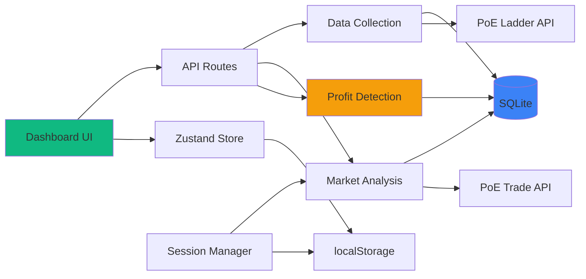

# Components

Based on the architectural patterns, tech stack, and data models, here are the major logical components across the fullstack:

## Data Collection Service

**Responsibility:** Fetches and parses character data from PoE Ladder API, handling rate limiting and caching

**Key Interfaces:**

- `fetchLadderData(league: string): Promise<Character[]>`
- `parseCharacterData(raw: any): Character`
- `cacheCharacterData(characters: Character[]): void`

**Dependencies:** PoE Ladder API, SQLite database, File cache

**Technology Stack:** TypeScript, Node.js fetch API, better-sqlite3

## Market Analysis Engine

**Responsibility:** Searches trade API for item prices and availability, correlates with demand data

**Key Interfaces:**

- `searchTradeListings(itemName: string, filters: any): Promise<TradeListing[]>`
- `calculateMarketPrice(listings: TradeListing[]): PriceData`
- `detectPriceAnomalies(listings: TradeListing[]): Anomaly[]`

**Dependencies:** PoE Trade API, User session (POESESSID), Rate limiter

**Technology Stack:** TypeScript, Browser fetch with CORS handling

## Profit Detection Algorithm

**Responsibility:** Core algorithm that identifies profitable opportunities by comparing demand vs market prices

**Key Interfaces:**

- `calculateDemandScore(item: string, usage: Map): number`
- `identifyOpportunities(demand: DemandMetrics[], prices: PriceData[]): ProfitOpportunity[]`
- `calculateConfidence(opportunity: ProfitOpportunity): number`

**Dependencies:** DemandMetrics, Market prices, Historical data

**Technology Stack:** TypeScript, Pure computation (no external deps)

## Dashboard UI

**Responsibility:** Main user interface displaying profit opportunities with filtering and sorting

**Key Interfaces:**

- `<OpportunityList />` - Displays filtered opportunities
- `<FilterPanel />` - User preference controls
- `<RefreshButton />` - Manual data refresh trigger

**Dependencies:** Zustand store, API routes, Radix UI components

**Technology Stack:** React, TypeScript, TailwindCSS, Radix UI

## Local Storage Manager

**Responsibility:** Manages SQLite database and browser storage for persistence

**Key Interfaces:**

- `saveToDatabase(table: string, data: any): void`
- `queryDatabase(query: string): any[]`
- `cleanOldData(daysOld: number): void`

**Dependencies:** SQLite, IndexedDB, localStorage

**Technology Stack:** better-sqlite3, Browser Storage APIs

## Session Manager

**Responsibility:** Handles POESESSID storage and validation securely

**Key Interfaces:**

- `setSession(sessionId: string): Promise<void>`
- `validateSession(): Promise<boolean>`
- `getSessionHeaders(): Headers`

**Dependencies:** localStorage, Crypto API for encryption

**Technology Stack:** Web Crypto API, TypeScript

## Component Interaction Diagram

