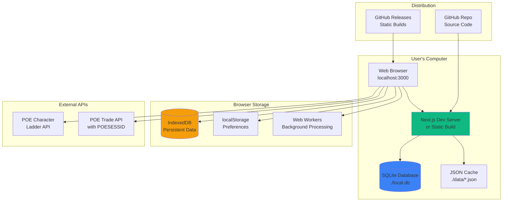

# High Level Architecture

## Technical Summary

The POE Profit Assistant operates as a **local-first desktop application** using Next.js running locally with all data processing happening client-side. The system connects directly to Path of Exile's Character Ladder and Trade APIs from the browser using user-provided credentials (POESESSID), eliminating need for backend infrastructure costs. Data persistence uses SQLite for development and IndexedDB for browser-based storage, with JSON file caching for API responses. The architecture prioritizes zero-cost operation during MVP validation while maintaining sub-200ms response times through local data processing. This approach enables solo developer validation of the core profit detection algorithm with no monthly hosting costs while providing a clear migration path to cloud infrastructure post-validation.

## Platform and Infrastructure Choice

**Platform:** Local-First Development (Zero Infrastructure Cost)
**Key Services:**

- Next.js Development Server (local port 3000)
- SQLite Database (file-based local storage)
- Browser IndexedDB (client-side persistence)
- localStorage (user preferences & session)
- JSON File Cache (./data directory)
- Node.js Scripts (optional background processing)

**Deployment Host and Regions:**

- Development: User's local machine
- Distribution: GitHub releases or static file sharing
- Optional: GitHub Pages for static hosting (free)

## Repository Structure

**Structure:** Monorepo - Single repository with local-first design
**Monorepo Tool:** Not needed (single app, no workspaces required)
**Package Organization:**

- Single Next.js app with all logic colocated
- Client-side analysis in `lib/analysis`
- Local database logic in `lib/db`
- API clients in `lib/api` (browser-compatible)
- Static data cache in `data/` directory

## High Level Architecture Diagram

## Architectural Patterns

- **Local-First Architecture:** All data processing and storage happens on user's machine - _Rationale:_ Zero infrastructure costs while validating core algorithm effectiveness
- **Client-Side Processing:** Browser-based analysis using Web Workers for heavy computation - _Rationale:_ Leverages user's computing power without server costs
- **File-Based Database:** SQLite for development, IndexedDB for production - _Rationale:_ No database hosting costs while maintaining full query capability
- **Direct API Pattern:** Browser connects directly to PoE APIs - _Rationale:_ Eliminates need for backend proxy while respecting rate limits
- **Progressive Enhancement:** Start with manual refresh, add auto-refresh later - _Rationale:_ Simpler initial implementation without background job complexity
- **Static Distribution:** Ship as static files users can run locally - _Rationale:_ No hosting required, users control their own instance
- **Component-Based UI:** Reusable React components with TypeScript - _Rationale:_ Maintainability and type safety for complex dashboard interactions
